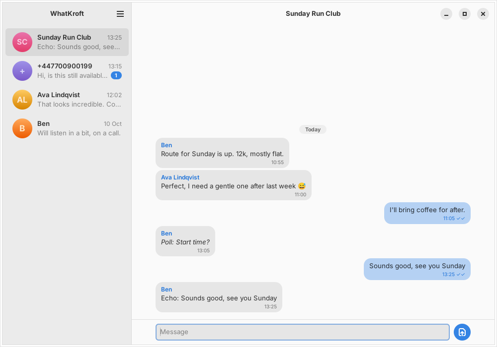

# WhatKroft

A native WhatsApp client for the Linux desktop, written in Rust. No embedded
browser: the interface is GTK4 and libadwaita, and the WhatsApp protocol is
spoken directly through [`whatsapp-rust`](https://github.com/oxidezap/whatsapp-rust).



*Screenshot taken in demo mode with made-up data.*

> **Unofficial.** WhatKroft is not affiliated with, endorsed by, or supported
> by WhatsApp or Meta. Using a third-party client may violate WhatsApp's Terms
> of Service and can lead to account restrictions or a ban. Use it at your own
> risk, and consider trying it with a spare number first.

## Status

Early alpha. This is the first milestone: link a device, see your chats, read
and send text.

Working:

- Linking as a companion device by QR code, with a persistent session
- Chat list with names, previews, times and unread counts
- Reading conversations (direct and group), with day separators
- Sending text, with sent / delivered / read ticks
- History import from the phone on first link
- Local SQLite store, so the app opens instantly and reads offline
- Desktop notifications for incoming messages while the window is open
- Adaptive layout: list and conversation side by side, or one at a time when narrow
- Unlinking from the menu

Not yet:

- Media. Photos, videos, voice notes, documents, stickers, locations, contacts
  and polls show as a short description (for example "Photo: caption"); they
  cannot be viewed or sent
- Replies, reactions, edits, deletions, mentions, link previews
- Read receipts. Opening a chat clears the unread count locally but does not
  tell the sender you have read it
- Typing indicators and presence
- Voice and video calls
- Search, archive, pin, mute, starred messages
- Status updates and channels (hidden for now)
- Notifications while the window is closed
- Loading messages older than the newest 200 in a chat

## How it fits together

```
┌────────────┐   Unix socket, JSON lines   ┌──────────────┐   WhatsApp   ┌──────────┐
│ whatkroft  │ ◄─────────────────────────► │ whatkroftd   │ ◄──────────► │ WhatsApp │
│ GTK4 window│                             │ daemon       │   protocol   │ servers  │
└────────────┘                             │ ├ session.db │              └──────────┘
                                           │ └ chats.db   │
                                           └──────────────┘
```

| Crate | What it is |
| --- | --- |
| `crates/whatkroftd` | Background daemon. Owns the WhatsApp connection (`wa.rs`), the chat database (`store.rs`) and the socket server (`ipc.rs`). |
| `crates/whatkroft` | The GTK4 / libadwaita window. Talks only to the daemon. |
| `crates/whatkroft-ipc` | The wire protocol both sides share. |

The window starts the daemon if it is not already running. The daemon keeps
running after the window closes, so the session stays connected.

## Building

You need Rust 1.94 or newer, GTK 4.12 or newer and libadwaita 1.4 or newer.

```sh
# Arch, CachyOS
sudo pacman -S --needed rust gtk4 libadwaita

# Fedora
sudo dnf install cargo gtk4-devel libadwaita-devel

# Debian, Ubuntu
sudo apt install cargo libgtk-4-dev libadwaita-1-dev
```

```sh
git clone https://github.com/morningjon/whatkroft
cd whatkroft
cargo build --release
```

## Running

```sh
./target/release/whatkroft
```

On first launch a QR code appears. On your phone open WhatsApp, go to
Settings, then Linked devices, tap Link a device and scan it. Your chats then
sync from the phone, which can take a minute.

To install both binaries into `~/.cargo/bin`:

```sh
cargo install --path crates/whatkroftd
cargo install --path crates/whatkroft
```

`data/` has a desktop entry and an optional systemd user unit for running the
daemon in the background from login.

### Demo mode

To try the interface without linking an account, start the daemon with a
made-up account served from memory, then open the window:

```sh
./target/release/whatkroftd --demo &
./target/release/whatkroft
```

`--demo-pairing` stays on the pairing screen instead. Nothing is sent
anywhere in either mode.

## Where things are kept

| Path | Contents |
| --- | --- |
| `$XDG_DATA_HOME/whatkroft/session.db` | WhatsApp session keys. Anyone who copies this file can act as your linked device. |
| `$XDG_DATA_HOME/whatkroft/chats.db` | Your chats and messages, unencrypted. |
| `$XDG_RUNTIME_DIR/whatkroft/daemon.sock` | Control socket. |

`XDG_DATA_HOME` defaults to `~/.local/share`. Both directories are created
readable by your user only. To reset completely, unlink from the menu (or
from your phone), stop `whatkroftd` and delete the data directory.

Set `RUST_LOG=debug` for verbose logs. `WHATKROFT_SOCKET` overrides the socket
path, and `whatkroftd --data-dir` the data directory.

## Development

```sh
cargo test --workspace
cargo clippy --workspace --all-targets
cargo fmt --all
```

The socket protocol is plain JSON, one message per line, and is defined in
`crates/whatkroft-ipc/src/lib.rs`. You can poke the daemon by hand:

```sh
echo '{"id":1,"method":"list_chats"}' | nc -U "$XDG_RUNTIME_DIR/whatkroft/daemon.sock"
```

## Licence

GPL-3.0-or-later. See [LICENSE](LICENSE).

WhatsApp is a trademark of its owner. This project uses the name only to
describe what it connects to.
